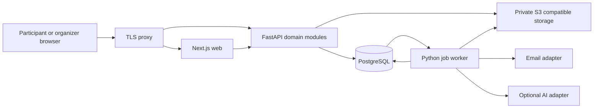

# Alignn system design

Status: Approved by the user in chat on 3 November 2026. Repository: `abhigyan6/alignn-web`, private. Reference repository: `Vaidik04/Alignn`, commit `021664d0dbe5a266e9abb451598931bed3877132`.

The user selected a fresh Next.js frontend, FastAPI backend and PostgreSQL database. Product and operating defaults below were proposed by the designer and approved with this specification in chat. The original repository remains a reference; it will not be overwritten or forked into the new repository's history.

## 1 Intent and release scope

Alignn helps students find relevant opportunities, understand eligibility, meet teammates, participate in events and track their next steps. Preserve the existing project's useful deterministic matching and career workflows while building a credible participant and organizer platform.

The first complete release covers profiles, skills and private resumes; searchable jobs, internships, hackathons and competitions; saved opportunities; external application tracking; verified organizer accounts; free hosted events with individual or team registration; file or link submission rounds; manual scoring; published results; notifications; and platform moderation. Hosted participation and external application are explicit opportunity modes. All screens, API operations, fixtures and documentation use Alignn branding.

A participant-reported external application stage is distinct from an organizer-issued event outcome. AI may explain structured evidence but cannot decide eligibility, moderation, scores or winners. Mock provider data and sample hiring predictions must remain visibly labeled in development and excluded from production fixtures.

Payments, executable coding assessments, automatic proctoring, live chat, a full learning marketplace and native mobile apps are deferred. Text-and-file submissions with manual evaluation are the initial competition model. Retain deterministic skill-gap planning and a basic assistant after the core participation flow; advanced radar prediction is a later milestone with verified history. No existing-user database migration is assumed for this fresh build.

## 2 Architecture and alternatives

Use a modular monolith: Next.js renders the web app; FastAPI owns business rules and database writes; a separate Python worker handles jobs. One repository contains `apps/web`, `apps/api`, `packages/api-client`, `packages/design-tokens`, `infra` and `docs`. Keep Python modules separated by domain: identity, profiles, organizations, opportunities, eligibility, matching, teams, participation, evaluations, notifications and moderation. SQLAlchemy models and Alembic migrations belong to the API. Generate TypeScript API types from its OpenAPI contract and check drift in CI. The web app has no independent ORM or competing authorization layer.

Selected approach: Next.js plus FastAPI retains Python domain knowledge while permitting new contracts, permissions and interfaces. A TypeScript-only rebuild reduces language switching but requires porting the eligibility and matching engines; the user chose the former. Microservices add deployment and distributed-transaction complexity without measured demand. MongoDB is not selected because core membership, registration and scoring relationships benefit from foreign keys and transactions. A separate search cluster is deferred until measured relevance or latency warrants it.

Serve web and API under the same origin through a reverse proxy, routing `/api/v1/*` to FastAPI. Browser requests and server-rendered requests forward only the required session cookie. Internal API addresses are deployment configuration, never public secrets. Only published opportunity content is publicly cached. Personalized responses, resumes, submissions and organizer data are private and uncached.

PostgreSQL 18 is the proposed baseline for development, integration tests and production, subject to provider availability at deployment. Use Docker Compose locally for PostgreSQL, an S3-compatible object store and a local mail inbox. Use a managed PostgreSQL instance for deployment; no vendor account or paid resource is provisioned by this design. Lock dependency versions during implementation rather than copying the reference project's broad minimum versions.

## 3 Identity and permissions

Public signup creates a participant account only. Passwords use Argon2id. Verification and password-reset tokens are random, hashed at rest, single-use and expiring; reset and login responses avoid disclosing whether an email exists. Verification is required for registration and organizer requests. Local development uses a local inbox; production email configuration is a launch requirement.

Use a random opaque session token in a Secure, HttpOnly, SameSite=Lax cookie. Store its hash, user ID, creation time, last activity, expiry and revocation in PostgreSQL. Default absolute lifetime is seven days and idle expiry is 24 hours. Rotate on login, password reset and privilege changes. Logout revokes the current session; account disablement invalidates every session. Session creation is rate limited; secrets have no production fallback values. Validate Origin and a session-bound CSRF token on mutations, including login and logout. Cookies may be non-Secure only on local HTTP development.

Users may be participants and organization members simultaneously. `organization_memberships` assign owner, manager or reviewer permissions within one organization. Ownership transfer is explicit and cannot leave an organization without an owner. Organizers request an organization; a platform administrator verifies it before publication. Unverified organizers may create drafts. Reviewers see assigned submissions, not every participant resume. Platform administration is provisioned through an explicit operator command, never public signup or a frontend toggle. Check object ownership and membership in every API handler, including file access and exports.

## 4 Database and domain model

Use UUID primary keys, timezone-aware timestamps, foreign keys, check constraints and database uniqueness. Core structured relationships are relational. JSONB is reserved for versioned form definitions, rule configurations and captured evaluation evidence. Store academic CGPA as a bounded decimal, not float. Store event display timezone separately from UTC instants.

| Domain | Main records and constraints |
|---|---|
| Identity | users with unique normalized email; sessions with unique token hash; verification and reset tokens; organization requests |
| Profiles | one profile per user; skills and aliases; unique profile-skill pairs; projects; private file metadata |
| Organizations | organizations; unique organization-user memberships; verification history; organization invitations |
| Opportunities | organization-owned opportunities; slug; type; participation mode; publication state; schedule; rules versions; skill requirements; external source identity |
| Discovery | unique user-opportunity saves; feedback; versioned match snapshots; PostgreSQL full-text search document |
| External tracking | unique user-opportunity application; append-only participant stage events and next actions |
| Teams | opportunity-scoped teams; membership invitations; unique opportunity-user accepted membership; captain; membership lock |
| Hosted participation | registrations; unique registration-opportunity participant rows; roster and eligibility snapshots; round eligibility; submission revisions |
| Evaluation | reviewer assignments; rubric versions; unique assignment-criterion scores; append-only finalization and result publication records |
| Operations | outbox jobs; notification deliveries; API idempotency records; moderation audit; minimal telemetry |

A hosted opportunity chooses individual or team registration at publication. A team is scoped to that opportunity. Team size, capacity and member eligibility are evaluated at registration, which freezes the accepted roster. Only accepted members count; a user can occupy only one registration per opportunity. Capacity counts registrations, meaning teams for team events and people for individual events. No waitlist is included initially. A captain submits for the team; individual participants submit for themselves. Invitations require recipient acceptance and expire after 72 hours or registration close, whichever comes first. Public teammate discovery exposes only opted-in public profile fields; resumes and email addresses are private.

Lifecycle: opportunities move through DRAFT, PENDING_REVIEW, PUBLISHED, CLOSED, COMPLETED or CANCELLED. Rejected drafts return with a moderation reason. Publication requires verified ownership, validated dates and a complete policy. Registration moves CONFIRMED to WITHDRAWN or DISQUALIFIED. Withdrawal before registration close releases capacity; after close it preserves the historical roster and does not reopen entry. Cancellation stops new submissions and sends one notice per participant.

Rounds have ordered sequence, opening and closing times and a versioned rubric. First-round eligibility comes from registration. Subsequent rounds require organizer advancement from finalized prior results. Manual scores and organizer selection decide advancement; ties are resolved explicitly by an organizer with an audit reason. Results stay private until an explicit publish action. No automatic leaderboard reveals unpublished scores. Published results are corrected through a new version with a reason; the prior version remains in audit history.

## 5 Transactions and request lifecycle

For registration, authenticate and check CSRF; normalize the idempotency key and request hash; acquire the opportunity row lock; then lock the team if applicable. All membership and registration mutations take locks in the same order. Check verified user status, publication, server-side deadline, capacity, team size, accepted membership and deterministic eligibility. Capture rule version and profile evidence; insert registration and participant roster; increment capacity; append audit and outbox records; persist the response under the idempotency key; commit once. A uniqueness violation maps to a domain conflict. External email is never sent before commit.

Lock the opportunity before any organizer schedule, capacity or policy edit. Freeze registration mode and eligibility policy once the first registration exists. Disallow reducing capacity below the current count. Deadline extensions before close are audited and reschedule reminders; moving a deadline earlier after registration starts is disallowed. A deliberate organizer close overrides an extension. Registration eligibility snapshots remain the source of truth for admission; profile edits change future match evaluations, not historical admission.

Submission creates an immutable revision referencing a completed, scanned private upload or a validated HTTPS project link. Finalization locks the round and registration, checks allowed roster and round eligibility, and compares database server time with the deadline. A submission counts only if its atomic database acceptance check, performed after the required locks are acquired, passes before the deadline. Return success only after that transaction commits. This clarifies the server acceptance instant for implementation; network arrival and the client clock do not establish timeliness. Uploading a file or saving a draft alone does not count. Repeated finalization returns the existing result for the same idempotency key; a different accepted revision supersedes the earlier one only before close. Preserve the full revision history.

## 6 APIs and search contracts

Version HTTP APIs under `/api/v1`. OpenAPI is the source for generated web types; commit a schema snapshot and client generation command. Errors return a stable code, readable message, request ID and field details, excluding internal exceptions. Use 401 for missing sessions, 403 for denied capability, 404 for inaccessible objects, 409 for capacity or state conflicts and 422 for invalid input. Paginated lists return items, next cursor and applied sort. Bound page size to 100.

| API family | Main operations |
|---|---|
| `/auth` and `/me` | signup, verify email, login, logout, reset password, session list, profile, skills, files and account deletion |
| `/organizations` | request organization, invite members, accept invitations, manage verified organization and transfer ownership |
| `/opportunities` | public search and detail; authenticated eligibility, fit, save and team discovery |
| `/organizer/opportunities` | owned drafts, submit for review, schedules, rounds, registrations and exports |
| `/opportunities/{id}/registrations` | idempotent individual or team registration; current registration; withdrawal |
| `/teams` and `/invitations` | create event team, invite, accept, decline and leave before roster lock |
| `/rounds/{id}/submissions` | create revision and idempotently finalize; private authorized retrieval |
| `/evaluations` and `/results` | assigned rubric scores, finalize review, advance participants and publish result version |
| `/applications` and `/notifications` | external tracking events, next actions, delivery list and read status |
| `/admin` | verification, publication moderation, audit, failed-job inspection and controlled replay |

Registration responses contain registration ID, opportunity ID, status, roster user IDs, policy version and created timestamp. Clients never supply scores, organizer ownership or an admission status. Mutating commands use optimistic version checks where appropriate; stale updates receive 409 rather than overwriting newer content.

Use PostgreSQL full-text search with GIN indexes over title, organization and description; B-tree indexes support publication state, event type, deadline and cursor ordering. Sort eligibility and match across the candidate result set before pagination. For personalized match order, materialize versioned scores per profile revision and opportunity version in a worker; return ranking freshness. While ranking is pending, return a clearly labeled chronological order rather than claiming a global match order. Eligibility is always computed from the relevant current policy for a new registration. Missing mandatory profile attributes never pass a substring check. Match confidence is evidence completeness, not a prediction of getting hired.

## 7 Jobs and failure behavior

The application transaction inserts outbox rows in PostgreSQL. Workers lease available jobs using row locks with SKIP LOCKED, commit the lease before external calls, heartbeat long tasks and reclaim expired leases. This is at-least-once delivery. Use unique domain keys for each reminder threshold, deadline version, recipient and channel. Retain notification uniqueness separately from expiring API idempotency records. API idempotency keys are scoped by actor and operation, store a request hash and response, and expire after 24 hours. A reused key with different input returns 409.

Default external timeout is 10 seconds; retry transient network failures and 429/5xx responses up to five attempts with exponential backoff and jitter over no more than 24 hours. Invalid addresses and other permanent 4xx errors become terminal immediately. Exhausted jobs become failed and visible to operators. Email providers must support deduplication or accept a documented possibility of duplicate email after an uncertain timeout; in-app notifications remain unique. A scheduler sweeps due reminders every minute; reminders expire at the underlying deadline and are never sent late after the event closes.

Provider imports are disabled until configured, identify records by provider plus external ID and use a transaction or savepoint per item. Imported opportunities enter moderation. AI explanations are optional jobs with strict time and cost budgets; failures return deterministic explanations. Raw resumes and contact details are excluded from AI context by default. AI is unnecessary for normal discovery or registration.

### Domain decisions resolved in builder review

The following designer-selected defaults were included in the user-approved design. Eligibility v1 supports canonical degree and branch IDs, graduation-year ranges, current academic years, location constraints and minimum CGPA thresholds. Explicit hard constraints combine with AND; allowed values within a constraint combine with OR. Work-mode and career-interest preferences influence fit unless explicitly published as mandatory. An absent mandatory attribute returns INCOMPLETE and blocks registration; a contradicted requirement returns INELIGIBLE. A rule-free opportunity is open to verified users. Degree and branch aliases use reviewed mappings, never substring acceptance. CGPA stores value and scale, initially 4 or 10; rules publish a minimum per accepted scale, with no automatic GPA conversion. An unsupported scale is INCOMPLETE until clarified.

Matching v1 uses the reference engine's current factor weights: technical skills 35, project evidence 25, career interests 20, work-mode and location preferences 10, and title or role keyword similarity 10 percent. Match by canonical skill ID with reviewed aliases; required skills receive twice the weight of preferred skills within the technical factor. Missing evidence scores zero in that factor and does not cause remaining weights to expand. The keyword component uses normalized deterministic token overlap, not an embedding service. Clamp each factor to zero through 100, compute the weighted mean and round once. Version the formula and include factor evidence; implementation fixtures define worked examples. Eligibility remains a separate admission gate. Profile confidence reports completeness only.

Rubric criteria have a maximum score and positive weight, with weights normalized to sum to one. Each reviewer finalizes a complete scorecard for an assigned registration. The normalized total is the weighted sum of criterion scores divided by their maxima, scaled to 100. With multiple reviewers, take the arithmetic mean of all finalized reviewer totals. Publication is blocked until every active assignment is finalized; removing an assignment requires an audited organizer action. Freeze rubric weights after the first finalized scorecard. Ties require an explicit organizer decision with a reason before advancement or winner publication. Changes after publication create a new result version. No automatic prizes or payouts exist.

Organizers can see a registered participant's name, public profile, institution, team, registration status, eligibility verdict and relevant submission. Contact email is shared only through an event-specific consent field shown before registration; refusing contact sharing does not block participation. Resume access is a separate optional per-event grant and is never included in bulk exports by default. Export columns follow the same permissions. Raw grade evidence and private rule snapshots are restricted to the participant and audited platform support for disputes. Reviewers receive submissions and rubric fields only. Disqualification is an organizer decision with a visible reason and an appeal contact, not an automatic consequence of a later profile change.

Career insights in milestone 4 are limited to a skill-gap list against up to 20 saved or explicitly selected published opportunities, plus a deterministic weekly focus list derived from approaching deadlines, next actions and missing profile fields. Each item links to its source record and states the reason. The basic assistant presents these structured results and, if configured, an optional AI paraphrase. It does not perform web research, open-ended chat, course recommendations or job applications. Completion means identical structured output with AI disabled, correct user isolation and a working fallback on provider failure.

## 8 Files security and privacy

Private buckets hold resumes and submissions; PostgreSQL stores ownership, object key, purpose, checksum, size and scan status. Uploads use short-lived signed operations to quarantine. The worker verifies actual file type, allowed size and a malware scan before marking an object usable. Resume limit is 10 MB for PDF or DOCX; event submissions allow PDF, PPTX, ZIP or a project link up to 25 MB, with no execution or extraction of submitted code. Download authorization precedes a short-lived signed URL. Unscanned or failed objects cannot be submitted or viewed by reviewers. Serve untrusted files as attachments.

TLS, least-privilege service credentials, secret injection, safe production startup, structured redacted logs and request IDs are required. Do not log session tokens, passwords, resume text or submission contents. Anonymous users see only published public data. Drafts and unpublished results require ownership checks. Exports require organizer permission, pagination and audit.

Proposed retention defaults: abandoned quarantine objects seven days, expired sessions seven days after expiry, operational logs 30 days and idempotency responses 24 hours. Account deletion revokes access immediately and queues removal of profile and private objects; completed event records retain only pseudonymous integrity references unless a separately agreed retention policy requires more. Backups age out on their configured schedule and deletion requests are reapplied after restoration. Product notices must explain retained event records. These are engineering defaults, not a legal compliance claim. Production residency, retention and backup policies require owner review before public launch.

## 9 Frontend design system and brand

Use Alignn in product prose and the supplied lowercase wordmark relationship in branding. Preserve the looping symbol as the visual motif. The attached board is a raster reference, not a vector master. A reviewed vector or approved newly drawn variant is required before final asset delivery. No exact recreation is implied by a text approximation in concepts.

The first light editorial and dark studio concepts were too simple for the user. The revised proposal is a category-led marketplace with cobalt actions, light surfaces, custom event posters, a sculptural loop composition and a dedicated event detail view. References include Unstop for opportunity categories, Devpost for participation metadata, Handshake for expressive student branding and Wellfound for audience separation. The user approved this richer marketplace direction in chat on 3 November 2026. Prioritize opportunity scanning, clear deadlines and honest participation state. Manrope headings and Inter body copy are the initial font proposal from the supplied board, with local font loading and license checks during implementation.

Define semantic light and dark tokens for surfaces, text, borders, actions, focus, success, warning and destructive states. Start with a 4 px spacing unit, 16 px body text, a 1.25 type scale and constrained reading widths. Enforce WCAG AA contrast for actual text pairs and visible focus. Status meaning must survive without colour. Controls support keyboard navigation, reduced motion, zoom and comfortable touch targets. Motion should explain state changes; avoid decoration that competes with content.

Core components include buttons, inputs, filters, searchable selects, badges, opportunity rows, event cards, tabs, drawers, dialogs, tables, forms, toast announcements and skeletons. Each needs loading, empty, error, disabled, selected and success states where applicable. Display absolute deadline dates and timezone alongside relative urgency. Distinguish external Apply actions from hosted Register actions. A participant home focuses on saved opportunities, upcoming deadlines and next actions; organizer navigation focuses on events, registrations, submissions and results. Mobile layouts preserve task order and expose filters in a drawer. No nested card stacks or promotional banner clutter in work screens.

Skills for implementation: interface-design for product hierarchy and tokens, design-taste-frontend for public pages, graphic-designer for brand assets, better-accessibility for interaction QA and a motion skill only where behavior benefits. Load stage-specific skills after design approval; do not activate every installed methodology.

## 10 Operations and verification

Provisional load-test envelope, not a traffic forecast: 10,000 accounts, 20,000 opportunities, a 1,000-person event, 100 simultaneous registration attempts and 50 search requests per second. Begin with two stateless API instances and one worker in a deployment rehearsal; actual resource sizes follow measurement. PostgreSQL remains authoritative if email, AI or object storage is degraded. Registration must fail closed on database failure and never claim an uncommitted success.

Proposed launch targets: zero overbooking or duplicate registrations in race tests; search and non-upload API p95 below 500 ms at the test envelope; reminder processing delay below five minutes under normal operation; 99.5 percent monthly core API availability. Alert on sustained 5xx above 2 percent for five minutes, oldest runnable job above five minutes, failed jobs and exhausted database pools. Track scan latency, authorization failures and AI fallback separately. SLOs are proposed acceptance targets, not measured achievements.

Deploy web, API and worker as independent processes from one commit. Run Alembic once as a release task; application startup never creates tables. Use backward-compatible expand-and-contract migrations, separate health and readiness endpoints and private staging credentials. Keep production demo seeding disabled. Back up PostgreSQL with managed point-in-time recovery and test a restore to staging; proposed RPO is 15 minutes and RTO is four hours, contingent on provider capability and a successful rehearsal. Object recovery must also be tested.

CI requires lint and type checks, API schema compatibility, migrations on real PostgreSQL, domain tests, authorization matrix tests, worker retries and browser end-to-end flows. Critical tests cover admin signup denial, cross-organization access denial, unknown eligibility attributes, last-seat races, team membership races, deadline finalization, unpublished result privacy, private file access, expired sessions, CSRF, idempotent job replay and AI outage. Visually inspect desktop and mobile at 360, 768 and 1440 px, keyboard flow and 200 percent zoom. No claim is made that the old tests currently pass.

## 11 Rename and migration boundary

The fresh app removes CareerConnect from visible copy, metadata, navigation, email templates, API descriptions, prompts, development seed identities, database names, cookie names, environment examples and documentation. Use `alignn.test` for demo emails, not an assumed owned public domain. Remove localStorage bearer-token patterns rather than renaming their keys. Search the complete new source tree for old product names and inspect generated metadata and browser titles before handoff.

No production data import, credential rotation in the original repo, DNS change or deployment is included in design approval. If existing users must migrate, add an explicit schema mapping and session invalidation plan before importing any records. Preserve source attribution and inspect the original repository's license before copying implementation code or assets. Prefer fresh implementation with carried-forward behavior and tests where permitted.

## 12 Decisions and delivery sequence

User-confirmed: full app, new `alignn-web` repository, use Superpowers, Next.js plus FastAPI, and the supplied Alignn branding as reference with freedom to change colours.

Approved defaults: private repository under the authenticated `abhigyan6` account; hosted and external participation; free events; manual file/link rounds; organizer verification; PostgreSQL outbox; opaque cookie sessions; fresh database; no migration of old users. No hosting budget or vendor has been selected. Those deployment decisions can remain open until staging; public release requires configured email, storage, malware scanning, monitoring, backups and retention.

After this design is approved, write the implementation plan, create the repository and commit this specification under `docs/superpowers/specs/2026-11-03-alignn-design.md`. Milestone 1 establishes the repository, migrations, sessions and design tokens. Milestone 2 delivers discovery, profiles and external tracking. Milestone 3 delivers one complete hosted team event from draft through moderation, registration, submission, review and results. Milestone 4 adds worker delivery, career insights, accessibility and operational validation. Each milestone must run as a coherent working app; test evidence and limitations accompany handoff. Publishing and paid infrastructure require their own explicit user request.

## References

- Source assessment: `alignn-project-assessment.md`, based on the referenced Git commit and static inspection.
- PostgreSQL full-text indexes: https://www.postgresql.org/docs/current/textsearch-indexes.html
- PostgreSQL row locking and SKIP LOCKED: https://www.postgresql.org/docs/current/sql-select.html
- Linear interface hierarchy reference: https://linear.app/now/behind-the-latest-design-refresh
- Brand reference: user-supplied Alignn brand foundations board.
- Marketplace references inspected live: https://unstop.com/ , https://devpost.com/hackathons , https://joinhandshake.com/students/ and https://wellfound.com/ .
